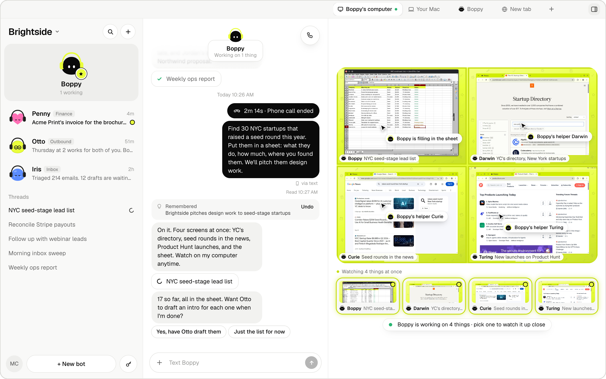
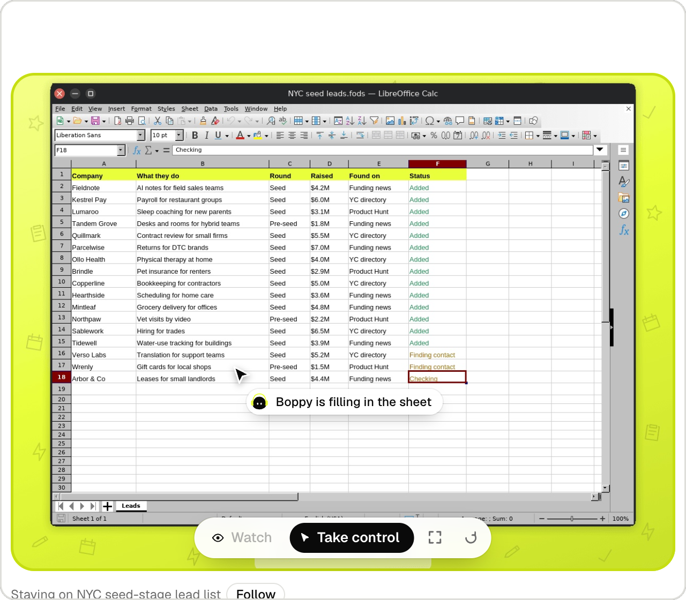
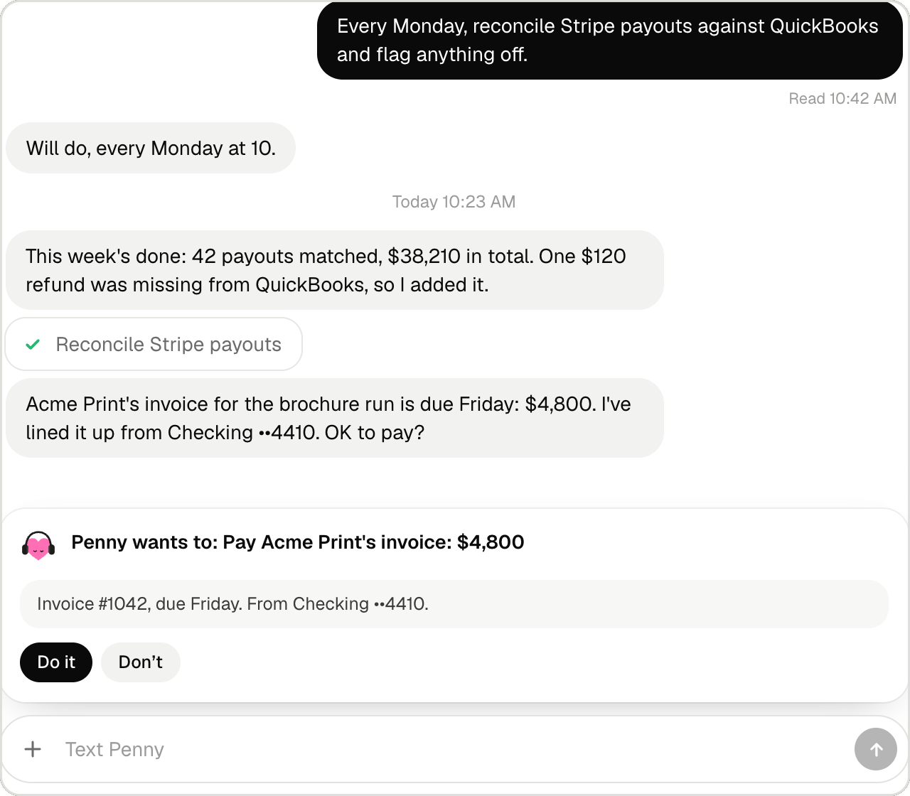
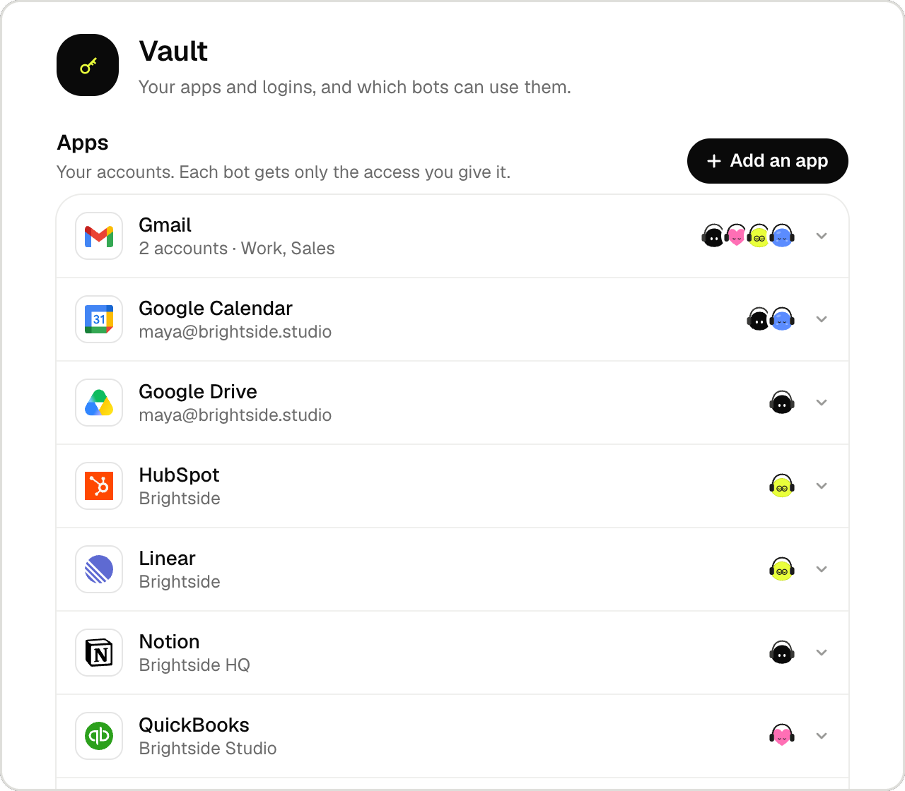
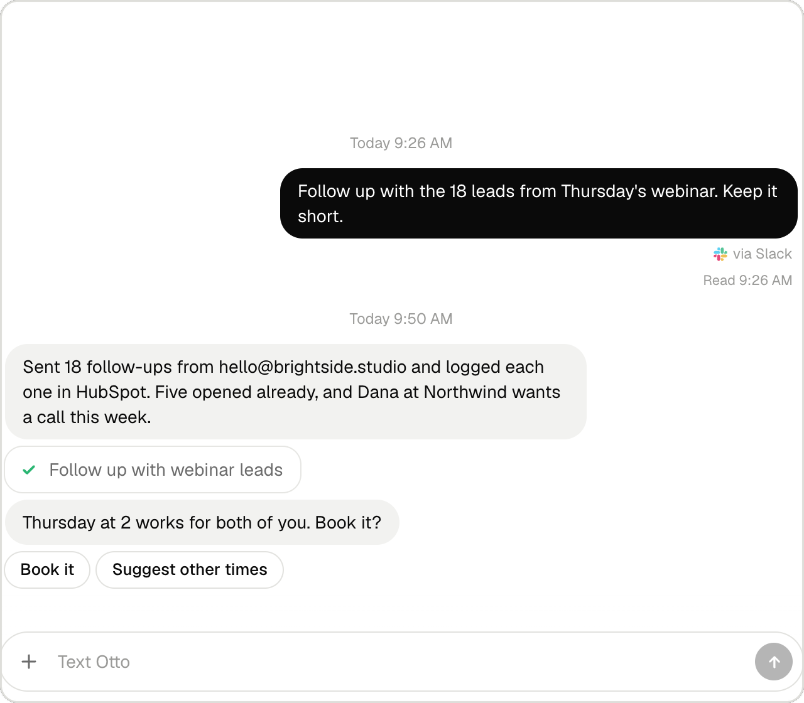

<p align="center">
  
</p>

<h1 align="center">Better than GrokBot</h1>

<p align="center">
  <b>A team of AI bots that runs your business ops.</b><br>
  Each bot has its own computer, email and phone number, and remembers everything.
</p>

<p align="center">
  <a href="#quick-start"><b>Quick start</b></a> ·
  <a href="https://betterthangrokbot.com">betterthangrokbot.com</a> ·
  <a href="#where-it-runs">Mac, Windows, phone</a> ·
  <a href="LICENSE">FSL-1.1-ALv2</a>
</p>

<p align="center">
  <sub><b>Unofficial, independently maintained fork</b> of <a href="https://github.com/OrgoAI/bops">Bops</a> by Organic
  Intelligence, Inc., kept under its original <a href="LICENSE">FSL-1.1-ALv2</a> license and notices. Not affiliated with or
  endorsed by Organic Intelligence or xAI. "Bops" and the Bops logo are Organic Intelligence's trademarks
  (<a href="TRADEMARK.md">TRADEMARK.md</a>).</sub>
</p>

<p align="center">
  
</p>

## Quick start

**Easiest:** paste this repo's link into Claude Code or Codex and say:

> **Install Better than GrokBot on this computer. Follow INSTALL.md.**

It installs and starts the app, asks for your keys one at a time (hidden as you paste), then helps
you set up your agents. It starts as a blank canvas: no agents, data or accounts but yours.
[INSTALL.md](INSTALL.md) has the steps and a startup checklist.

**By hand** (macOS, Windows or Linux). You need Node.js 24+, Git, an
[OpenRouter](https://openrouter.ai) or OpenAI API key, and an [Orgo](https://orgo.ai) API key (the
bots' computers; a self-hosted install won't open without one).

```bash
git clone https://github.com/jbellsolutions/better-than-grokbot.git
cd better-than-grokbot
npm ci
cp .env.example .env.local                      # Windows: copy .env.example .env.local
node scripts/set-key.cjs OPENROUTER_API_KEY     # or OPENAI_API_KEY
node scripts/set-key.cjs ORGO_API_KEY
npm run build
npm run serve                                   # http://localhost:3210
```

Open **http://localhost:3210** and keep that terminal open while you use it. Add more keys
(Composio, Honcho, AgentMail…) the same way and restart; [INSTALL.md](INSTALL.md) says what each does.

## Where it runs

The app is a server on your computer plus a window onto it. The window can be a browser tab, an
installed app, or your phone.

| | What you get | How |
|---|---|---|
| **Mac** (Apple silicon) | Everything, including bots working in your Mac's own apps, the native app and the always-on service | Quick start, then optionally `npm run app:build` ([full guide](docs/SELF_HOSTING.md)) |
| **Windows** | Everything except working in your own computer's apps: chat, teams, the bots' cloud computers, models, connected apps, email, saved logins, Slack | Quick start, then in Edge or Chrome: **⋯ → Apps → Install Better than GrokBot**. It gets its own window and Start-menu icon. |
| **Linux** | Same as Windows | Same as Windows |
| **Phone** (iPhone, Android) | Your team in your pocket: chat with any bot, approve what they ask, watch their computers, change settings | See below |

Mac-only for now: working in your own computer's apps (Codex computer use), the packaged desktop
app, and the always-on login service. On a Mac, saved logins and tokens (the Vault, Slack) go in the
Keychain; on Windows and Linux they go in `.data/secrets.json`, protected like the keys in
`.env.local`: on Linux only your user can read it; on Windows it's as private as its folder, so keep the
project inside your user folder.

### Use it on your phone

Your phone opens the app running on your computer, privately, through [Tailscale](https://tailscale.com)
(free for personal use). Nothing is exposed to the internet.

1. Install Tailscale on the computer and the phone, signed in to the same account.
2. On the computer: `tailscale serve --bg --https=8443 http://127.0.0.1:3210`
3. In `.env.local`, set `BOPS_PUBLIC_HOST` to the computer's Tailscale name (like
   `my-mac.tail1234.ts.net`) and `BOPS_TAILSCALE_USER` to your Tailscale login, so only you get in.
   Restart the app.
4. On the phone, open `https://my-mac.tail1234.ts.net:8443`, then **Share → Add to Home Screen**
   (iPhone, Safari) or **⋮ → Install app** (Android, Chrome).

It opens full screen with its own icon and shows one screen at a time: your team, a chat, or a bot's
computer. The back button (or Android's back gesture) goes back a screen. Connecting a new app (Gmail,
Slack…) opens its sign-in page on the computer; on the phone, tap **Open sign-in page** in the Vault
instead. The computer must be on and running the app.

## An AI team that gets work done

Better than GrokBot is an independently maintained, self-hosted Mac app based on Bops. The software is free under the included FSL license; AI and infrastructure providers bill separately.

You chat with your bots like teammates, and they do the work on their own cloud computers: inbox, pipeline, invoices, reports. Text them from your phone, call them and talk live, email them a task, or add them to Slack, Telegram and Discord. Wherever you reach them, they know who you are and what they did yesterday.

<table>
  <tr>
    <td width="50%" valign="top">
      
      <p><b>Its own computer, four screens.</b> A bot works on up to four things at once. Watch any screen live, take control, then hand it back.</p>
    </td>
    <td width="50%" valign="top">
      
      <p><b>Asks before it acts.</b> Reading runs at once. Sending, paying and deleting wait for your OK.</p>
    </td>
  </tr>
  <tr>
    <td width="50%" valign="top">
      
      <p><b>Your apps, your rules.</b> About 1,000 apps through Composio, several accounts each. Every bot gets only the access you give it.</p>
    </td>
    <td width="50%" valign="top">
      
      <p><b>Wherever you work.</b> Ask in Slack, by text, by email or on a call. The answer comes back the same way.</p>
    </td>
  </tr>
</table>

## What it does

- **A team per workspace.** A main bot (Better than GrokBot by default) runs the team and hands work to specialists you add. Bots talk to each other, keep threads, and report back in the chat.
- **Each bot has its own computer.** An [Orgo](https://orgo.ai) cloud computer with four screens. You can watch any screen live and take over.
- **Your Mac, when you say so.** Bots can work in your Mac's apps through Codex computer use, with your rules for which apps they may use.
- **Long-term memory** (Honcho): what you tell your bots, they remember, per workspace.
- **Your apps** (Composio): Gmail, Calendar, Slack, Notion, HubSpot and about 1,000 more, several accounts each. Reading runs at once; sending, creating or paying asks you first.
- **Email:** every bot has its own inbox (AgentMail). Mail you send a bot starts a task, and the answer comes back by email.
- **Texts and calls:** each workspace's main bot has a phone number (AgentPhone). Text it like a person (tapbacks, threads, reminders by text), or call it and talk to it live (GPT-Live over SIP).
- **Slack, Telegram and Discord:** add a bot like a teammate, and it answers where you asked.
- **Calls in the app:** talk to any bot by voice, and it can start tasks while you talk.
- **Routines and watches:** scheduled tasks and reminders, and screens a bot keeps an eye on for you.

## What it costs

The software is free. You pay the providers you connect, directly, on your own accounts:

- **Required:** a model provider (OpenRouter or OpenAI, pay per use) and Orgo (the bots' cloud computers).
- **Optional:** Composio (apps), Honcho (memory), AgentMail (email), AgentPhone (texts and calls), Typesafe.

There is no account with us, no analytics code, and no hosted service. With `BOPS_SELF_HOSTED=1` (the
default in `.env.example`) the app never calls Bops Cloud; it talks only to the providers you configure. (Organic
Intelligence sells the official hosted Bops at [bops.bot](https://bops.bot); that's a separate product.)

## Can I trust it?

- **Your keys stay on your computer.** They live in `.env.local` (ignored by Git, `chmod 600`). Saved
  logins and tokens go in the Mac's Keychain, or `.data/secrets.json` on Windows and Linux
  ([details](#where-it-runs)). No API sends them to the browser or to a model; the settings page only sees whether a key is set.
- **Your data stays on your computer.** Chats, agents and task history are in `.data/`, also ignored by
  Git. Model calls go to the provider you chose; the bots' work runs on your own Orgo computers.
- **Bots ask before they act.** Reading runs at once. Sending, posting, paying and deleting wait for your OK.
- **It only listens to you.** The server binds to `127.0.0.1`. Don't expose port 3210 to the internet;
  use Tailscale for your phone. Only webhook paths may be made public (through `edge/`), and they check signatures.
- **Bops only touches its own computers.** It creates and deletes Orgo computers only in its own
  workspace, and never deletes or resizes one you lend it.
- **The source is all here.** CI typechecks, tests, lints, builds on Windows, and scans the whole Git
  history for secrets on every change. The source ZIP on the website is a copy of this repo's source, with no keys or personal data.
- **Found a problem?** Report it privately: [SECURITY.md](SECURITY.md).

## How it works

```
Browser, installed app or phone ──► coordinator (Next.js, 127.0.0.1:3210, on your computer)
                                     ├─ chat, threads, routines, watches (state in .data/)
                                     ├─ OpenRouter or OpenAI: the bots' thinking
                                     ├─ Orgo: the bots' cloud computers (four screens each)
                                     ├─ Codex: work in your Mac's apps (Mac only)
                                     ├─ Honcho (memory), Composio (apps), AgentMail (email), AgentPhone (texts, calls)
                                     └─ public webhooks ◄── edge/ (optional relay) ◄── Slack, AgentPhone, OpenAI
```

## Project layout

| Path | What's there |
|---|---|
| `app/` | Next.js routes: the UI and `app/api/*` |
| `components/app/` | The app's UI; `components/message-ui/` is the iMessage-style chat kit |
| `lib/server/` | Everything server-side: chat engine, sessions, providers, state (`store.ts`) |
| `lib/types.ts` | The app state's shape |
| `desktop/` | The Electron shell |
| `vm/` | What runs on the bots' computers (screen MCP, browser helpers) |
| `orgo/` | The Orgo template builder |
| `edge/` | The public webhook relay |
| `docs/` | [The full guide](docs/SELF_HOSTING.md), Orgo API notes |
| `site/` | The betterthangrokbot.com page |

## More

- [INSTALL.md](INSTALL.md): installing step by step, the startup checklist, Slack setup.
- [docs/SELF_HOSTING.md](docs/SELF_HOSTING.md): the full guide: the Mac app, always-on service,
  recovery, separate teams, models and computers, texts and calls, signed releases.
- [HANDOFF.md](HANDOFF.md): for whoever maintains this next.
- [CONTRIBUTING.md](CONTRIBUTING.md) · [SECURITY.md](SECURITY.md) · [CODE_OF_CONDUCT.md](CODE_OF_CONDUCT.md)

## License

[FSL-1.1-ALv2](LICENSE) (Functional Source License, "fair source"): use, modify and self-host it
freely, except to offer a competing commercial service. Each version becomes Apache-2.0 two years
after release. Copyright Organic Intelligence, Inc.; this fork's changes are under the same license.
"Bops" and the Bops logo are Organic Intelligence's trademarks; see [TRADEMARK.md](TRADEMARK.md).
